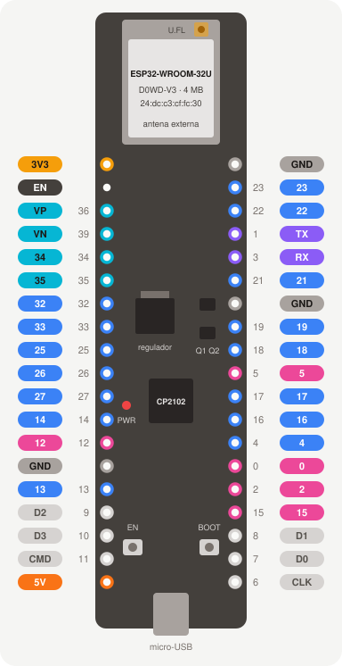

<div align="center">

# 🌦️ Station V1

**Estação meteorológica com ESP32, versão 1**


</div>

---

## 📡 O que ela vai medir

| | Medição | Status |
|:-:|---|---|
| 🌧️ | **Pluviometria** (chuva) |  |
| 🌡️ | **Temperatura** |  |
| 🧭 | **Pressão atmosférica** |  |
| 💧 | **Umidade** |  |

## 🔌 Placa

<p align="center">
  
</p>

| | |
|---|---|
| **Placa** | ESP32 DevKitC, 38 pinos |
| **Módulo** | ESP32-WROOM-32U, com antena externa (U.FL) |
| **Processador** | 2 núcleos, 240 MHz |
| **Memória** | 4 MB de flash |
| **Conexão** | Wi-Fi 2,4 GHz e Bluetooth 4.2 |
| **USB** | CP2102 (micro-USB) |

A função de cada pino e a alimentação estão em [`placa.html`](placa.html): baixe o arquivo e abra no navegador.

## ✅ O que já funciona

| | Recurso | |
|:-:|---|---|
| 📶 | **Wi-Fi configurado pelo celular**: a estação cria a própria rede e você escolhe o Wi-Fi de casa numa página |  |
| 🔄 | **Atualização pelo Wi-Fi (OTA)**: grava o código novo sem cabo USB |  |
| 🕒 | **Relógio**: conta a partir de 0 ao ligar e acerta a hora pela internet, corrigindo o que foi registrado antes |  |
| 🌡️ | **BME280**: temperatura, umidade, pressão, ponto de orvalho e umidade absoluta |  |
| 💾 | **Cartão microSD**: registro a cada 5 minutos com todas as medições, GPS e bateria |  |
| 🛰️ | **GPS**: posição, altitude, mapa e hora sem internet |  |
| 🌧️ | **Pluviômetro**: contagem de basculadas (milímetros depois da calibração) |  |
| 🔋 | **Bateria e painel solar**: carga, estado do carregador e modo economia |  |
| ☁️ | **Envio para a Climora**: a cada 5 min, por HTTPS, para o climora-ingest (com reenvio do que ficou pendente) |  |
| 😴 | **Sono leve**: dorme entre os ciclos de 5 min; a chuva continua contada por interrupção (o pino acorda a estação) |  |

## 📶 Conectar a estação ao Wi-Fi

1. Ligue a estação. Ela cria a rede **`Station-XXXX`**: as 4 letras finais vêm do MAC da placa, então cada estação tem a sua (a atual é `Station-FC30`).
2. Conecte o celular nessa rede. A página abre sozinha; se não abrir, acesse **http://192.168.4.1**.
3. Toque em **Procurar**, escolha a rede de casa, digite a senha e toque em **Conectar**.

Pronto: a estação grava a rede e passa a enviar por ela.

### 😴 Janela de 10 minutos e sono leve

- **Ao ligar** (energia ou botão **EN**): a rede `Station-XXXX` e a página em **http://192.168.4.1** ficam no ar por **10 minutos**. Só por essa rede: pelo Wi-Fi de casa a página não abre. Logo ao ligar ela faz **uma leitura e um envio na hora** (ex.: 01:47); depois segue nos horários cravados (01:50, 01:55, 02:00…), também durante os 10 minutos.
- **Depois:** rede e página desligam e a estação entra em **sono leve**. A cada 5 minutos (xx:00, xx:05…) ela acorda, lê os sensores, grava no cartão, conecta no Wi-Fi de casa, acerta a hora e envia para a Climora o que estiver pendente; sem internet, guarda e manda no ciclo seguinte. Depois volta a dormir.
- **Chuva:** contada por interrupção, como sempre. Dormindo, cada mudança do pino do pluviômetro acorda a estação em ~1 ms, a basculada é contada com o mesmo filtro (≥5 ms em 0, 50 ms entre basculadas) e ela volta a dormir.
- **Para abrir a página de novo:** desligue e ligue a estação (ou aperte **EN**).
- O processador roda a 80 MHz, o mínimo para o Wi-Fi.

## 🛠️ Gravar o código

**Antes da primeira compilação**, copie `.env.example` para `.env` e defina a senha da gravação pelo Wi-Fi e a chave do envio (o `.env` não vai para o git). A rede própria `Station-XXXX` é aberta, sem senha:

```ini
STATION_OTA_PASS=senha-da-gravacao-pelo-wifi  # mínimo 8 caracteres
STATION_KEY=a-mesma-do-climora-ingest        # sem ela, grava no SD mas não envia
```

| Como | Quando | Comando |
|---|---|---|
| 🔌 **USB** | Primeira vez, ou se o Wi-Fi não responder | `pio run -t upload` |
| 📶 **Wi-Fi** | Nos 10 minutos depois de ligar, com o computador na rede `Station-XXXX` | `pio run -e ota -t upload` |

O comando do Wi-Fi grava em `192.168.4.1` (a estação na própria rede, definido no `platformio.ini`). Não há mais nome `.local`. Ligue a estação, conecte o computador na `Station-XXXX` e grave dentro dos 10 minutos. Também funciona pelo IP dela no Wi-Fi de casa, durante a janela:

```sh
pio run -e ota -t upload --upload-port 192.168.1.xx
```

Para ver o que a estação está fazendo, abra o monitor serial com `pio device monitor` (pelo cabo USB).

## 🕒 Como funciona a hora

Ao ligar, a estação ainda não sabe que horas são: ela conta o tempo desde que ligou (`+00:00:00`, `+00:00:01`...). Quando o Wi-Fi conecta e a hora chega pela internet, tudo o que foi registrado antes é convertido para a hora real:

```
hora do registro = hora atual − (tempo ligado agora − tempo ligado no registro)
```
